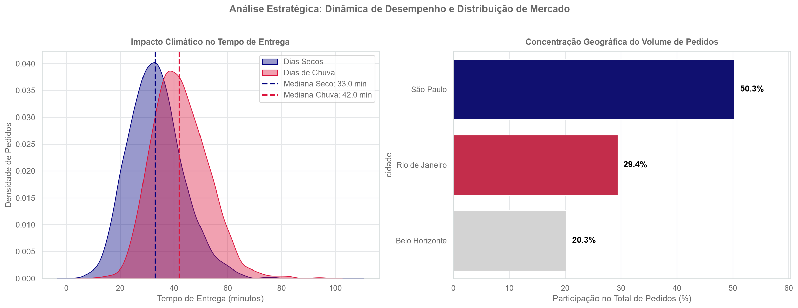

# 🛵 Projeto de Análise Estratégica e Logística de Delivery (2024)

# 📊 Diagnóstico Operacional e Comercial — Aplicativo de Delivery (2024)

Este repositório contém o ecossistema completo de engenharia, higienização e análise estatística de dados realizado sobre a base histórica de transações de um aplicativo de delivery durante o ano de 2024. O objetivo do projeto foi diagnosticar gargalos logísticos e validar hipóteses comerciais para subsidiar decisões estratégicas da diretoria executiva.

## 💻 Tecnologias Utilizadas
* **Linguagem:** Python 3
* **Manipulação e Limpeza:** Pandas, NumPy
* **Visualização de Dados:** Matplotlib, Seaborn
* **Estatística:** SciPy / Statsmodels

---

## 🛠️ Detalhamento da Higienização e Estrutura dos Dados

Antes da consolidação final da base, os dados brutos passaram por um processo rigoroso de auditoria para eliminação de ruídos sistêmicos:

1. **Remoção de Colunas Constantes:** As variáveis `pais` e `moeda` foram eliminadas por conterem valor único em toda a base (*Brasil* e *BRL*), não agregando variabilidade à análise.
2. **Tratamento de Strings e Padronização Monetária:** A coluna `valor_pedido` foi limpa com a remoção de caracteres de texto (como prefixos `"R$ "` e aspas), convertendo-se os valores para o tipo numérico decimal (`float`).
3. **Padronização de Variáveis Booleanas:** As colunas `cupom` e `cliente_novo` continham inconsistências de preenchimento (*Sim/Não*, *True/False*, *1/0*) e foram padronizadas para o tipo lógico booleano (`True`/`False`).
4. **Isolamento de Erros Sistêmicos de Logística (Outliers):**
   * Na variável `tempo_entrega_min`, valores negativos e o código de erro sistêmico `999` foram convertidos em nulos reais (`NaN`) para não distorcer as métricas.
   * Na variável `distancia_km`, registros menores ou iguais a zero e distâncias urbanas inviáveis (acima de 50 km por falha de geocodificação) também foram convertidos em `NaN`.
5. **Engenharia de Recursos Temporais (Feature Engineering):** A coluna original `data_hora` foi desmembrada em quatro novos eixos para análises sazonais: `data`, `mes`, `hora` e `dia_semana` (ordenado cronologicamente de Segunda a Domingo).
6. **Imputação por Moda:** Os 153 valores nulos residuais da coluna `plataforma` foram preenchidos utilizando a moda estatística da base (*Android*).

### Dicionário de Dados Consolidado

| Nome da Coluna | Tipo de Dado | % de Faltantes | Descrição do Atributo |
| :--- | :--- | :--- | :--- |
| `pedido_id` | int64 | 0,0% | Identificador único de cada transação. |
| `data_hora` | datetime / object | 0,0% | Carimbo completo de data e hora do pedido. |
| `data` | object (date) | 0,0% | Data civil da operação (AAAA-MM-DD). |
| `mes` | int64 | 0,0% | Mês numérico da transação (1 a 12). |
| `hora` | int64 | 0,0% | Janela horária de registro do pedido (0 a 23h). |
| `dia_semana` | category | 0,0% | Dia da semana ordenado (Segunda a Domingo). |
| `cidade` | category | 0,0% | Município onde o pedido foi realizado (SP, RJ, BH). |
| `bairro` | object | 0,0% | Bairro de destino da entrega. |
| `restaurante_id` | object | 0,0% | Identificador único do estabelecimento parceiro. |
| `tipo_cozinha` | category | 0,0% | Categoria culinária (Japonesa, Pizza, Hambúrguer, etc.). |
| `forma_pagamento` | category | 0,0% | Método de pagamento (Cartão, Pix, VR, Dinheiro). |
| `plataforma` | category | 0,0% | Canal de origem do pedido (Android, iOS, Web). |
| `valor_pedido` | float64 | 0,0% | Valor bruto dos itens de alimentação (R$). |
| `taxa_entrega` | float64 | 0,0% | Valor cobrado pelo frete de deslocamento (R$). |
| `distancia_km` | float64 | ~X,X% *(ajustar)* | Distância linear até o endereço do cliente (após limpeza). |
| `tempo_entrega_min`| float64 | ~X,X% *(ajustar)* | Tempo total gasto para conclusão da entrega (após limpeza). |
| `avaliacao` | float64 | ~16,0% | Nota voluntária de satisfação do cliente (1 a 5 estrelas). |
| `cupom` | bool | 0,0% | Indica se houve uso de cupom promocional (`True`/`False`). |
| `cliente_novo` | bool | 0,0% | Indica se é a primeira compra do usuário na plataforma. |
| `chuva` | bool | 0,0% | Condição climática no momento do pedido (`True`/`False`). |

---

## 🎯 Principais Achados do Projeto

O diagnóstico exploratório e os testes de hipóteses estatísticas revelaram os seguintes comportamentos críticos para o negócio:

* **Limite Crítico de Tolerância do Cliente:** A satisfação média do usuário sofre uma quebra abrupta e inicia uma queda contínua a partir da barreira de **35 minutos** de espera. Isso indica que um SLA comercial padrão de 45 minutos expõe a plataforma a uma zona crônica de detração de nota.
* **Multiplicador de Atraso Logístico por Chuva:** A precipitação atua como um fator de desaceleração sistêmica na malha urbana, alterando o coeficiente angular da regressão entre distância e tempo e adicionando entre **2 e 4 minutos por quilômetro rodado** em comparação aos períodos de tempo limpo.
* **Alavanca de Aquisição via Cupons:** O uso de cupons promocionais está associado a uma participação **23,2% maior de novos clientes** na base transacional, embora reduza de forma significativa o ticket mediano dos pedidos.
* **Forte Concentração Geográfica:** A operação apresenta alta dependência regional, com **São Paulo concentrando sozinha mais de 50%** de todo o volume e faturamento bruto anual da plataforma.
* **Assinaturas Distintas por Nicho Culinário:** Cada segmento gastronômico opera sob faixas de preço próprias, com a culinária **Japonesa liderando o maior ticket típico** da base, enquanto a categoria de Doces registra o menor desembolso unitário.

### Síntese Visual Operacional

A figura abaixo consolida os dois principais gargalos operacionais identificados: o impacto da chuva no tempo de deslocamento e o ponto de ruptura na satisfação do cliente aos 35 minutos:

---

## 🚀 Recomendações Acionáveis e Métricas

Para maximizar a eficiência logística e a rentabilidade da operação, foram estruturados três planos táticos fundamentados nos dados:

1. **Gatilho Logístico de Alerta Climático:** Reduzir automaticamente o raio máximo de entrega de restaurantes parceiros em 25% assim que alertas de chuva forem acionados, evitando rotas longas que ultrapassem a barreira dos 35 minutos.
   * *Métrica de Acompanhamento:* **Taxa de Pedidos acima de 35 min em Dias de Chuva** (Meta: < 5%).
2. **Segmentação de Cupons para Blindagem de Margem:** Restringir cupons agressivos de desconto exclusivamente ao primeiro pedido (aquisição). Para clientes recorrentes, substituir descontos diretos por benefícios de frete fixo ou programas de fidelidade.
   * *Métrica de Acompanhamento:* **Margem Média por Pedido Recorrente** (Meta: aumento de 8%).
3. **Expansão Comercial em Nichos de Alto Ticket:** Direcionar esforços de captação de novos restaurantes parceiros em categorias premium (como culinária Japonesa) nas praças secundárias (Rio de Janeiro e Belo Horizonte) para descentralizar a receita.
   * *Métrica de Acompanhamento:* **Participação de Praças Secundárias no Faturamento Global** (Meta: atingir 40% da receita total).

---

## ⚠️ Limitações da Análise

* **Ausência de Dados de Margem Líquida:** A base contempla apenas o faturamento bruto, impedindo calcular a lucratividade líquida por categoria ou o custo financeiro real (*burn rate*) das campanhas de cupom.
* **Viés de Autosseleção nas Avaliações:** O preenchimento da nota é opcional, o que tende a concentrar respostas de clientes nos extremos de experiência (muito satisfeitos ou muito frustrados), sub-representando clientes neutros.
* **Recorte Estático de 2024:** Por se tratar de uma base transacional sem histórico longitudinal multi-ano de identificação de usuários, não é possível mensurar retenção de longo prazo (*LTV*).

